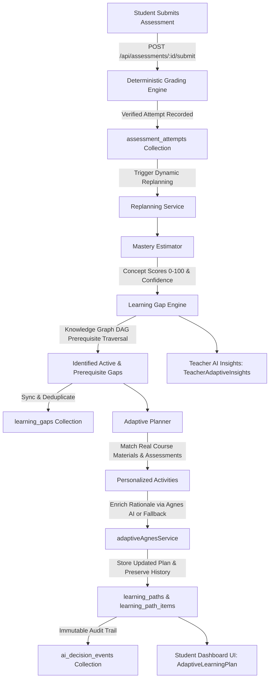

# EduPilot AI — Phase 10: Adaptive Learning Engine Specification & Architecture

## 1. Overview & Core Objective

The **Adaptive Learning Engine** provides evidence-based personalized learning, deterministic mastery estimation, knowledge-graph-driven gap detection, and dynamic replanning for enrolled students in EduPilot AI.

The engine answers seven fundamental pedagogical questions for every student:
1. **What does this student appear to understand?** — Evaluated via concept-level accuracy with recency weighting and sample-size confidence scaling.
2. **Which concepts require additional practice?** — Identified as active learning gaps where empirical performance falls below the difficulty threshold ($\le 60\%$).
3. **Which prerequisite concepts may be causing difficulty?** — Inferred by traversing the course knowledge graph Directed Acyclic Graph (DAG) to isolate root-cause foundational gaps.
4. **What should the student learn next?** — Prioritized learning path items addressing prerequisite bottlenecks first, then high-risk active gaps.
5. **Why is this activity recommended?** — Clear pedagogical rationale provided deterministically or enriched by Agnes 3.0 Flash.
6. **What evidence supports the recommendation?** — Full audit trail of verified question results, scores, and attempt timestamps.
7. **Did the student's understanding improve after the activity?** — Continuous tracking across repeated attempts with automatic gap resolution when mastery reaches $\ge 70\%$.

---

## 2. Architecture & Data Flow



### Core Service Boundaries
- **`src/services/learning/masteryEstimator.ts`**: Pure, deterministic mastery scoring with exponential recency decay, confidence categorization, and sample-size guarding.
- **`src/services/learning/learningGapEngine.ts`**: Graph-based learning gap identification, prerequisite bottleneck isolation, deduplication, and automatic gap resolution.
- **`src/services/learning/adaptivePlanner.ts`**: Recommendation engine linking real course materials (`materials`) and assessments (`assessments`) to active gaps, prioritizing foundational concepts first.
- **`src/services/learning/replanningService.ts`**: Orchestrates the end-to-end replanning lifecycle idempotently upon new assessment attempts or manual triggers.
- **`src/services/ai/adaptiveAgnesService.ts`**: Agnes 3.0 Flash integration providing Zod-validated pedagogical rationales with deterministic offline fallback.

---

## 3. Explainable Mastery Estimator

### 3.1 Scoring Assumptions & Formula
- **Mastery Scale**: 0 to 100 integer score.
- **Confidence Tiers**:
  - `insufficient`: $< 2$ evaluated questions for the concept. Score is treated as exploratory and does **not** trigger high-confidence intervention.
  - `low`: 2 to 3 questions evaluated.
  - `moderate`: 4 to 6 questions evaluated.
  - `high`: $\ge 7$ questions evaluated across assessments.
- **Recency Decay Factor ($0.8$)**:
  When a student completes multiple attempts over time, attempts are sorted by submission time descending. Each preceding attempt receives decaying weight:
  $$\text{weight}_i = \max(0.3, 0.8^i)$$
  where $i = 0$ is the most recent attempt.
- **Concept Score Calculation**:
  $$\text{Mastery Score} = \text{round}\left(100 \times \frac{\sum (\text{correct}_i \times \text{weight}_i)}{\sum (\text{questions}_i \times \text{weight}_i)}\right)$$
- **Boundary Invariants**:
  - Single question attempts never establish definitive mastery or difficulty.
  - Unanswered questions are not counted as incorrect unless explicitly submitted in an assessment attempt.
  - An empty history produces `not_assessed` status with 0% mastery and `insufficient` confidence.

---

## 4. Knowledge-Graph-Driven Learning Gap Engine

### 4.1 Gap Identification Criteria
1. **Direct Observed Weakness**:
   - Evaluated questions $\ge 2$
   - Mastery score $< 60\%$
   - Risk level assigned: `high` ($< 45\%$) or `medium` ($45\% - 59\%$)
2. **Prerequisite Root-Cause Bottleneck**:
   - If Concept $B$ is struggling, and the knowledge graph defines $A \to B$ ($A$ is prerequisite of $B$):
   - If Concept $A$ has score $< 60\%$ or has not been assessed, Concept $A$ is flagged with `isPrerequisiteGap: true` and `blockedConceptId: B`.
   - Remediating $A$ is given higher pedagogical priority than drilling $B$.
3. **Automatic Gap Resolution**:
   - If a student's recalculated mastery for a concept reaches $\ge 70\%$, any active gap for that concept is marked `resolved` with a timestamp and resolution evidence.
4. **Deduplication**:
   - Existing active gaps in Firestore for the same student and concept are updated in place rather than duplicated.

---

## 5. Prioritized Adaptive Learning Planner

### 5.1 Prioritization Sequence
1. **Priority 1 (Top)**: Prerequisite foundational gaps where downstream concepts are blocked.
2. **Priority 2**: High-risk direct learning gaps ($\text{mastery} < 45\%$).
3. **Priority 3**: Medium-risk direct learning gaps ($45\% \le \text{mastery} < 60\%$).
4. **Priority 4**: Reinforcement/practice for borderline or unassessed concepts.

### 5.2 Real Resource Linking (Zero Fabrication)
- The planner searches active, teacher-approved course materials (`materials` collection) matching the concept title, description, or objectives.
- It matches published course assessments (`assessments` collection) covering the target concept.
- **Missing Resource Integrity**: If no relevant material or assessment exists in the course for a concept, the activity is explicitly marked:
  ```ts
  resourceAvailable: false
  reason: "No teacher material currently uploaded for this concept. Review course syllabus or request guidance."
  ```
  The system **never** fabricates dummy URLs, placeholder textbook chapters, or nonexistent exams.

---

## 6. Dynamic Replanning Pipeline

### 6.1 Lifecycle & Triggers
1. **Assessment Submission**: In `POST /api/assessments/[assessmentId]/submit`, immediately following grade calculation and attempt storage, `replanningService.replanStudentCourse()` is executed.
2. **On-Demand Replan**: In `POST /api/learning/replan`, teachers or students can trigger an explicit refresh.
3. **Initial Plan Fetch**: In `GET /api/learning/plan`, if no plan exists yet, a plan is generated on the fly.

### 6.2 Idempotency & Audit Trail
- Preserves historical completed path items: Completed items are carried forward to maintain student progress history.
- Obsolete or resolved recommendations are cleanly archived.
- Every replan logs an audit entry to `ai_decision_events` with inputs, outputs, student ID, course ID, and trigger reason.

---

## 7. Agnes 3.0 Flash AI Integration

Agnes 3.0 Flash provides natural-language pedagogical rationale and study tips explaining *why* an activity is recommended, strictly grounded in the assessment results and concept graph.

- **Non-Authoritative Constraint**: AI never sets or alters numerical mastery scores, grades, or user permissions.
- **Zod Validation**: Responses are validated against `adaptiveRationaleSchema`.
- **Deterministic Offline Fallback**: If Agnes AI is offline, timed out, or rate-limited (HTTP 429), the engine transparently returns deterministic, rule-based rationales without degrading system availability.

---

## 8. Security & Authorization Matrix

| Route / Service | Caller Role | Permission Rules |
| :--- | :--- | :--- |
| `GET /api/learning/plan` | Student | Enrolled students can only access their own plan (`authUserId == studentId`). |
| `GET /api/learning/plan` | Teacher | Can inspect any enrolled student's plan in courses they own (`course.teacherId == authUserId`). |
| `POST /api/learning/replan` | Student / Teacher | Scoped strictly to caller's enrollment or teacher's course ownership. |
| `POST /api/learning/plan/item/:id/complete` | Student | Students can only mark their own path items complete. |
| `GET /api/learning/teacher-insights` | Teacher | Scoped strictly to courses owned by the authenticated teacher. Cross-course access forbidden. |
| Firestore `learning_gaps` | Student / Teacher | Read/write allowed only for matching `studentId` or authorized course teacher. |
| Firestore `learning_paths` | Student / Teacher | Read/write allowed only for matching `studentId` or authorized course teacher. |

---

## 9. Verification & Automated Test Results

The engine was verified via `scripts/test-phase10-adaptive-engine.mjs` executing 71 automated test assertions across 9 core suites:

```text
================================================================
   EDUPILOT AI — ADAPTIVE LEARNING ENGINE TEST SUITE
================================================================
── 1. Types & Model Architecture Integrity ───────────────────── (12/12 PASS)
── 2. Deterministic Mastery Estimator Logic ───────────────────── (11/11 PASS)
── 3. Knowledge Graph Learning Gap Engine ─────────────────────── (8/8 PASS)
── 4. Prioritized Adaptive Planner ────────────────────────────── (6/6 PASS)
── 5. Dynamic Replanning Pipeline ─────────────────────────────── (8/8 PASS)
── 6. Agnes 3.0 Flash AI Integration & Fallback ──────────────── (5/5 PASS)
── 7. REST APIs & Security Invariants ─────────────────────────── (7/7 PASS)
── 8. UI Integration (Student & Teacher Dashboards) ──────────── (7/7 PASS)
── 9. Firestore Security Rules Integrity ─────────────────────── (7/7 PASS)
================================================================
TEST SUMMARY: 71 PASSED, 0 FAILED (TOTAL: 71)
================================================================
```

### Quality Assurance Checks:
- **TypeScript**: `npx tsc --noEmit` — 0 errors.
- **ESLint**: `npm run lint` — 0 errors, 0 warnings.
- **Production Build**: `npm run build` — 46/46 pages optimized and built successfully.
- **Regression Verification**: `scripts/verify-phase8-e2e.mjs` — All source trust and conflict resolution tests passing.

---

## 10. Firestore Deployment Instructions

Deploy updated security rules:
```bash
firebase deploy --only firestore:rules
```

Ensure indexes are active in `firestore.indexes.json`:
- `learning_gaps`: `(courseId ASC, studentId ASC, status ASC)`
- `learning_paths`: `(courseId ASC, studentId ASC, updatedAt DESC)`
- `learning_path_items`: `(pathId ASC, priority ASC)`
- `assessment_attempts`: `(courseId ASC, studentId ASC, startedAt DESC)`
- `assessment_attempts`: `(courseId ASC, startedAt DESC)`

---

## 11. Known Limitations & Future Enhancements

1. **Bayesian Knowledge Tracing (BKT)**: Current mastery estimation uses exponential recency decay. Future phases could incorporate formal BKT slip and guess parameters.
2. **Spaced Repetition Scheduling**: Plan items currently use static priority ordering; spaced repetition review intervals (e.g. SuperMemo SM-2) can be layered on top in future phases.
3. **Multi-Teacher Collaboration**: Currently courses have a single primary `teacherId`; co-teacher permissions can be enabled when team teaching is introduced.
